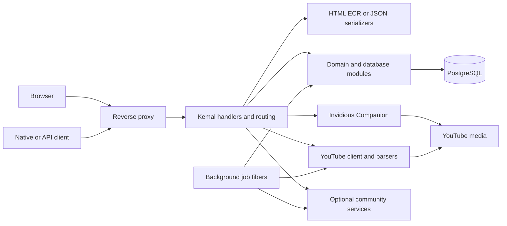

# System architecture

[Documentation index](README.md)

The application is a Crystal/Kemal process backed by PostgreSQL. HTTP handlers, domain modules, parsing, ECR rendering and background jobs share that process. Jobs run as Crystal fibers; configuration names containing `threads` describe refresh concurrency, not separate operating-system services.

Some media flows bypass the application through a public companion endpoint or Google media URL. This diagram describes responsibilities; [playback](playback.md) explains actual delivery paths.

## Startup

[src/invidious.cr](../src/invidious.cr) requires dependencies and application modules, then:

1. Loads and validates configuration, exposing `CONFIG` and `HMAC_KEY`.
2. Connects PostgreSQL as `PG_DB`; failure stops startup.
3. Derives the public host URL and build-time Git/version/asset identifiers.
4. Constructs YouTube, avatar and companion connection pools.
5. Parses CLI options; `--migrate` runs migrations and exits instead of starting the server.
6. Initializes output/logging, optionally checks tables and always checks the account schema.
7. Registers eligible refresh/maintenance jobs and starts their fibers.
8. Installs the request hook, routes, error handlers, middleware and static serving.
9. Starts Kemal, binding configured TCP host/port or a Unix socket.

Player dependencies are resolved during compilation unless `-Dskip_videojs_download` is used. This is separate from startup. Assets/locales/config SQL still need to be available at runtime; run from the installation directory or set an appropriate service working directory.

## Request processing

[handlers.cr](../src/invidious/helpers/handlers.cr) installs selective compression, API CORS, optional abusable-endpoint blocking, authentication and frame restrictions. `/api/v1/auth/*` requests authenticate before route execution. Bearer credentials take precedence over a browser SID when both are present. Cookie writes validate CSRF; token requests validate method/path scopes.

[before_all.cr](../src/invidious/routes/before_all.cr) builds request context: guest or account preferences, locale, theme, user/session where applicable, browser profile, current page and security headers. Query overrides such as `hl`, `dark_mode` and `thin_mode` alter rendering for that request. Media/image proxy paths return early from much of the page-context work.

Route handlers obtain upstream/cache/domain data, enforce resource ownership, invoke presentation helpers and return an ECR page, JSON, XML/Atom, VTT, a redirect or a media stream. [routing.cr](../src/invidious/routing.cr) is the complete route registry. Browser AJAX endpoints coexist with the versioned API; they are not interchangeable contracts.

## Layers and ownership

| Layer | Responsibilities | Examples |
| --- | --- | --- |
| Routes | Parse requests, enforce auth/ownership, set status/headers, choose representation | `routes/watch.cr`, `routes/api/v1/authenticated.cr` |
| Domain modules | Fetch/normalize content, choose stream settings, implement account/library behavior | `videos.cr`, `playlists.cr`, `clips.cr`, `native_playlists.cr` |
| YouTube backend | Request contexts, protobuf continuations, renderer extraction, safe outbound clients | `yt_backend/`, `channels/`, `comments/`, `search/` |
| Database | Parameterized persistence, retention, transactions, account identities and shared caches | `database/` |
| Presentation | Pagination, card visibility, avatar/progress decoration and watch-page view data | `frontend/` |
| Serialization | Stable API field names and optional metadata enrichment | `jsonify/api_v1/` |
| Views/assets | HTML structure, CSS, player and progressive browser enhancements | `views/`, `assets/js/` |

Not every older module follows a strict layered pattern; global database/config/pools remain common dependencies. The [source map](reference/source-map.md) links every implementation module rather than assuming an unused framework convention.

## State and concurrency

Persistent local state includes account preferences, credentials, subscriptions, playlist ownership, saved sources, clip ranges, watch history, playback positions, chat offsets and encrypted DeArrow identities. Shared PostgreSQL caches retain channel/video data, avatars, handles and AiSList snapshots. Process-local caches bound SponsorBlock/DeArrow lookups and in-flight work. Browser storage keeps fallback and UI state scoped by an HMAC-derived profile identifier.

Account changes use transactions and credential/session checks. Native sparse preference patches lock the stored JSON before merging; chat settings use compare-and-set retries and can return 409 on contention. Upstream channel lookups for SponsorBlock overrides happen before acquiring the account preference lock. Notifications bridge PostgreSQL LISTEN/NOTIFY and client streams through bounded Crystal channels.

Instances sharing one database must use consistent secrets and compatible schemas. Process-local caches and active SSE streams remain per process. Do not infer horizontal-deployment coordination or safe mixed-version migrations from the shared database alone.

## Errors and resilience

HTML routes render localized information/error templates; JSON routes use endpoint-specific error statuses/bodies. The registered 404 fallback attempts supported bare channel/video identifiers and otherwise redirects to `/`; it is not simply a static 404 page. The auth middleware returns JSON 403 for failed credentials/scopes/CSRF. Upstream parsers and proxy validation can fail independently of local storage. Optional enhancements generally fall back to ordinary playback/cards; account writes and identity decryption must report failure rather than silently replacing ownership or private identities.

Video metadata expires; clips and history retain saved descriptive metadata beyond that cache. AiSList refreshes retain the last valid list independently on download failure. Unresolved AI handles remain visible. Downloads re-resolve server-selected tracks so a client cannot submit an arbitrary destination URL. See [integrations](integrations.md), [database](database.md) and [troubleshooting](troubleshooting.md).
