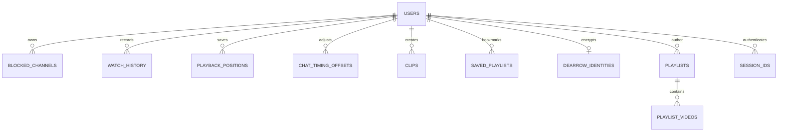

# Database and data model

[Documentation index](README.md)

PostgreSQL is mandatory. Application persistence is implemented in [database/](../src/invidious/database), with [complete fresh-install DDL](reference/schema.md) and [all migrations](reference/migrations.md). SQLite supports NewPipe imports and selected isolated tests; it is not an alternative production backend.

## Persistent tables

| Table | Purpose and important relationships |
| --- | --- |
| `users` | Immutable `email` owner ID, mutable case-insensitive `username`, credential version/hash, preference JSON text, subscription/notification/watched arrays, private feed token and refresh flag |
| `session_ids` | Browser or `v1:` API session identifier, owner, issued time and nullable expiry; revoked/deleted through account logic |
| `tv_pairings` | Hashed TV approval codes, expiry/state, approving account/session and persisted polling interval; account deletion nulls ownership |
| `auth_rate_limits` | HMAC-derived shared throttle key, attempts and window expiry |
| `nonces` | Expiring signed-response nonces consumed by nonce-backed validation |
| `playlists` | Local playlist/source legacy rows, author ownership, privacy enum, metadata and ordered occurrence-index array |
| `playlist_videos` | Saved video metadata keyed by `(index,plid)`; plid references playlists; occurrence index differs from displayed position |
| `saved_playlists` | Per-account source bookmark `(email,source_id)`, serialized metadata, optional mix seed and save time |
| `watch_history` | Per-account/video retained metadata, release/latest-watch date, archived dates and nullable positive duration |
| `playback_positions` | Per-account/video integer seconds and updated time; cascade on account deletion |
| `chat_timing_offsets` | Per-account/video signed offset milliseconds, ±3,600,000; zero means no stored override |
| `blocked_channels` | Per-account canonical channel ID/name/time; cascade on account deletion |
| `dearrow_identities` | Account-bound authenticated ciphertext; key lives outside PostgreSQL |
| `clips` | Public immutable native clip ID, owner/source/channel, title, start/end ms, saved source title/channel/duration and creation time |
| `channels` | Channel author, refresh/deletion/push subscription status |
| `channel_videos` | Cached subscribed-channel video metadata including membership/live state |
| `videos` | Re-fetchable detailed metadata text and update time; UNLOGGED cache table |
| `channel_avatars` | Canonical channel ID → observed avatar URL/time, learned through normal responses |
| `channel_handles` | Canonical ID → nullable normalized handle, checked/expiry timestamps |
| `ai_slist_snapshots` | Last valid blocklist/warnlist text and successful update timestamp |
| `annotations` | Optional archived annotation XML cache |
| `invidious_migrations` | Runtime-created migration version tracking, rather than a fresh-install SQL file |

There is also a `privacy` enum (`Public`, `Unlisted`, `Private`) and per-account materialized views named `subscriptions_<sha256(owner)>`. Arrays and serialized text are retained for compatibility; do not assume normalized join tables exist for every account collection.

The diagram includes logical ownership as well as SQL foreign keys. `playlists.author` and `session_ids.email` are application-enforced relationships, not declared user foreign keys in the supplied DDL. Account deletion explicitly removes sessions and owned playlist rows. The exact FK/cascade/constraint truth is in [schema](reference/schema.md).

## Ownership and retained metadata

`users.email` must remain stable across a rename. Tables using `email`/`owner` and HMAC-derived browser profiles depend on it. New account owner IDs are random; usernames are not safe storage identities. `users.token` is a private feed credential, distinct from session IDs and signed bearer JSON.

Local playlists use the array of occurrence indexes to maintain order; repeated upstream video IDs remain separate rows. Native clip ranges are immutable and store enough source metadata to list clips without fetching the original. Saved playlists store references to changing sources, not a frozen playlist copy. History retains descriptive metadata independently of the six-hour video cache.

## Transactions and concurrency

Credential verification, issuance, rename, password change and deletion share account-row transaction locking. This prevents a concurrent credential change from leaving newly issued stale credentials valid. Unique indexes enforce case-insensitive username collisions. Migration 17 locks account/session tables and aborts on conflicting legacy names without merging/deleting users.

Sparse native preference patches select stored JSON `FOR UPDATE`, validate before mutation, merge supported fields and preserve unrelated raw keys. Chat preferences use compare-and-set retries and return conflict after bounded contention. Account deletion removes owned playlists/videos in the same transaction as account deletion. Individual imports are not equivalent to one account-wide transaction.

## Retention and caches

| State | Lifecycle |
| --- | --- |
| Detailed video cache | Cleanup removes entries older than six hours; UNLOGGED contents are disposable and can be lost after an unclean PostgreSQL restart |
| Playback positions | At most 1000 per account; older than 365 days expire; disabling sync/clearing history removes them |
| Nonces | Expire and are deleted by cleanup; consumed nonces cannot validate again |
| Browser sessions | 30 days; selection rejects expired sessions |
| Native sessions | 30-day signature and database expiry; legacy API token rules can differ |
| Authentication throttles | Time-window expiry governs admission; stored keys do not represent permanent account lockout |
| AiSList snapshots | Last successful copy survives failed refresh and restarts |
| Handle cache | Success seven days; failure/missing handle retried after one hour; job prunes long-expired rows |
| Avatar cache | Learned/replaced by observed upstream data; no avatar-only miss request or age-triggered fetch |
| Clips/library/history | Persistent until explicit deletion/account deletion; video cache eviction does not remove them |

SponsorBlock and DeArrow winning-title caches are process-local, not tables. Their eviction does not delete user settings or encrypted identities. Annotated cache persistence depends on configuration.

## Schema creation and upgrades

`./invidious --migrate` loads numbered subclasses in order, runs each pending `up` inside its own transaction, and records the version in that transaction. Rerunning skips completed versions. There is no down-migration command. New installs should use this current migration path after creating an empty database.

`check_tables` is a legacy startup integrity mechanism. It can create missing tables and alter/drop/reorder selected columns; authentication tables have guards and must use the transactional account migration. Startup always checks for the current account columns. Do not use `check_tables` as a zero-risk schema reconciler or as permission to run old/new binaries concurrently.

The Docker init hook only runs for a fresh PostgreSQL volume and does not execute every newer SQL table file. The documented explicit migrator creates/tracks the complete schema. `config/migrate-scripts/` contains historical shell migrations, separate from the modern runner; do not run them all on a current installation.

## Migration milestones

Versions 1–9 create the original tables; 10 makes videos UNLOGGED; 11–13 add playback, blocking and identities; 14 detailed history; 15 membership metadata; 16 history duration; 17 secured account identities/sessions/throttles; 18 chat offsets; 19 clips; 20 saved sources/backfill; 21 avatars; 22 AiSList snapshots/handle cache; 23 TV pairing grants. See the linked [migration inventory](reference/migrations.md) for exact implementations.

Back up and stop every writer before upgrades, especially the account-schema transition. Restore into a separate empty database for rollback; never point the prior binary's legacy schema checker at an upgraded production database. [Operations](operations.md) provides the full procedure.
