# D6 replay and dedicated chat checkpoint

[Master plan](README.md) · [Contract](d6-chat-contract.md) · [Utility checkpoint](d6-utilities-checkpoint.md) · [Source and check evidence](review/d6-chat-evidence.json)

The replay and dedicated chat workstream is accepted. D6 remains in progress:
same-player clip creation/library and enhancement editors/coexistence still need
implementation and acceptance. D7–D9 remain pending.

Replay now owns the selected watch utility panel, not player placement. There is
no browser overlay, geometry, opacity, movement or resizing UI/code in the reader.
The same media survives settings, filters, timestamp seeks, utility changes and
native fullscreen. Unavailable replay, failed/invalid data, empty replay, future
messages and filtered-out results remain distinct. Explicit Retry recovers failed
reads. Manual reading retains its anchor until Sync Chat returns to current time;
older cached rows remain available without exceeding 120 DOM rows. Cache limits
are 5,000 messages and 24 ranges. Removed IDs and duplicate continuations cannot
resurrect messages or create a tight request loop. Aborts, generations and
page/profile/disposal ownership reject late completions, including transports
that ignore cancellation. Fullscreen suspends the external reader and restores
its cached panel on return.

One shared Display/Filters form serves watch advanced settings and the dedicated
`/preferences?section=chat` destination. One explicit Save/Discard area owns those
settings. Per-video timing has its own labeled Save/Discard area and endpoint.
The editor names account versus profile-local storage, keeps literal failed
drafts, reports quota/partial/uncertain results truthfully, and offers explicit
read-back without repeating an ambiguous mutation. Native ranges and UTF-8 byte
limits are enforced. Invalid patterns retain the previously applied filter and
have associated inline errors. Numeric inputs and sliders share exact accepted
values; invalid numeric drafts leave the prior slider position intact. Identifier
and regex fields remain LTR within RTL forms. The dialog close header remains
visible while its form scrolls. Preferred panel width actually affects the grid
and is constrained to available space.

Account timestamps/filters use the existing dedicated PATCH. Font, width and
hide-user-ID remain profile-local; guest settings remain in their existing local
store. Offsets remain per video. Native overlay fields and historical raw values
are preserved. The PATCH merges the latest raw preference document, preserving
unknown fields and unrelated concurrent category edits. An unrelated patch does
not normalize historical geometry. No-JavaScript account timestamp/filter forms
retain their CSRF/profile/validation behavior; browser-only guest/display settings
explain their JavaScript requirement. Shared Settings search links to the editor
with ordinary navigation, outside the general category preference manifest.

Validation on 27 October 2026:

- Complete cumulative desktop suite: **172/172**, Chromium and Firefox, including
  all earlier D1–D5 and D6 transcript/comment cases.
- Complete QoL regressions: **28/28**. Shared chat/general validators: **15 examples**.
- Guarded task-owned local PostgreSQL settings/admin/chat checks pass native
  scopes, CSRF, ranges, account isolation, raw compatibility, no-JavaScript drafts,
  stale profiles and concurrent raw merges. Per-video offset boundaries and
  exact native bearer scopes are covered through production handlers.
- Fresh production fixture compilation and ordinary parser/API fixture checks
  pass. Normal and API-only type checks pass; existing monotonic-time warnings
  remain. JavaScript syntax, Crystal formatting and documentation/whitespace
  checks pass.
- Eleven retained views were inspected across Light/Dark, 1280/1440/1920 desktop,
  enlarged RTL, forced colors, standalone Settings, field errors and timing.
  Eight approved D1 images and ten original native comment JSON hashes remain
  unchanged.

The [manifest](review/d6-chat-evidence.json) records source/image hashes and case
names. These are local checks with synthetic media/intercepted browser responses;
no live upstream or deployed-server verification is claimed. Historical earlier
stage manifests are preserved. Retired-style assertions and broader cleanup
remain D8, and final semantic documentation reconciliation remains D9.

## Inspected views

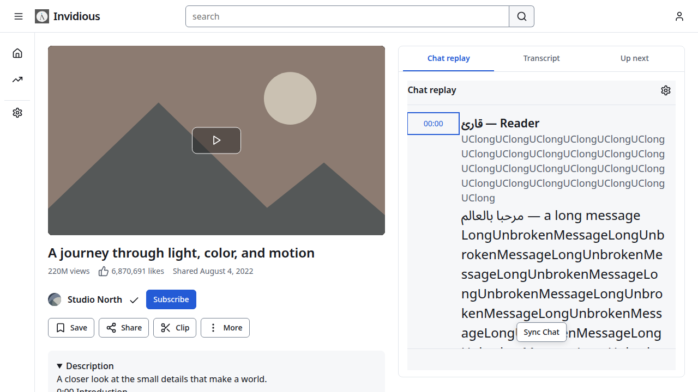

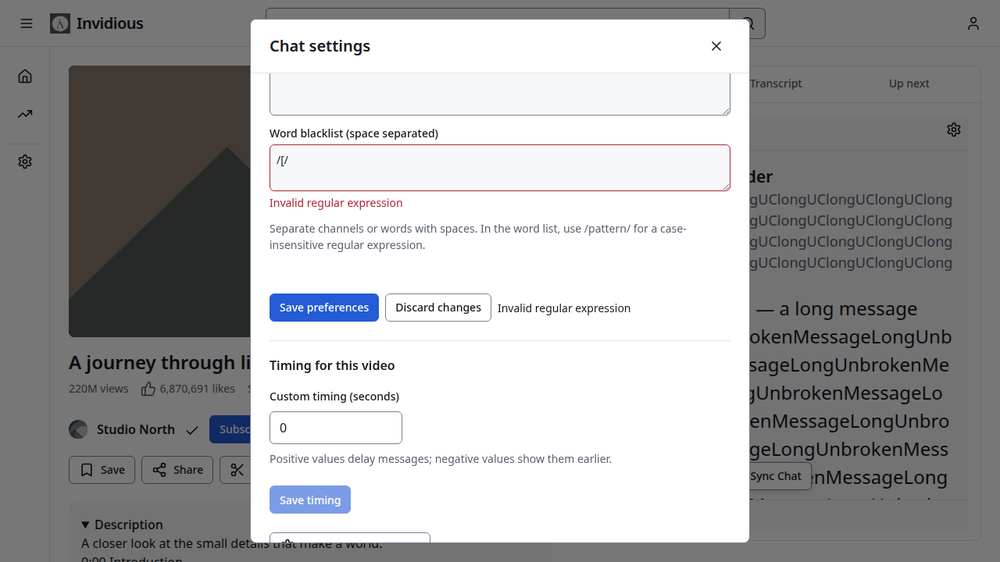

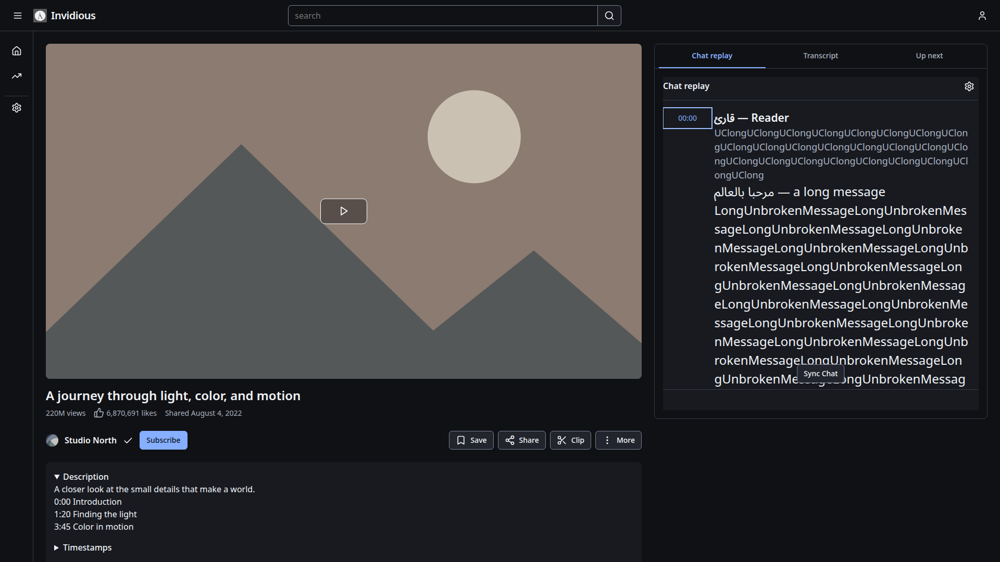

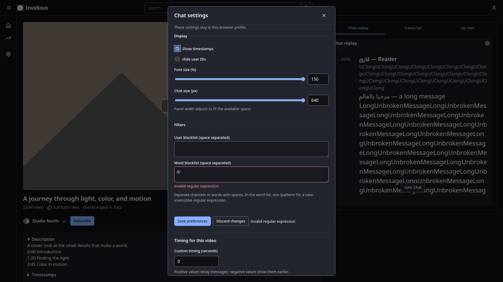

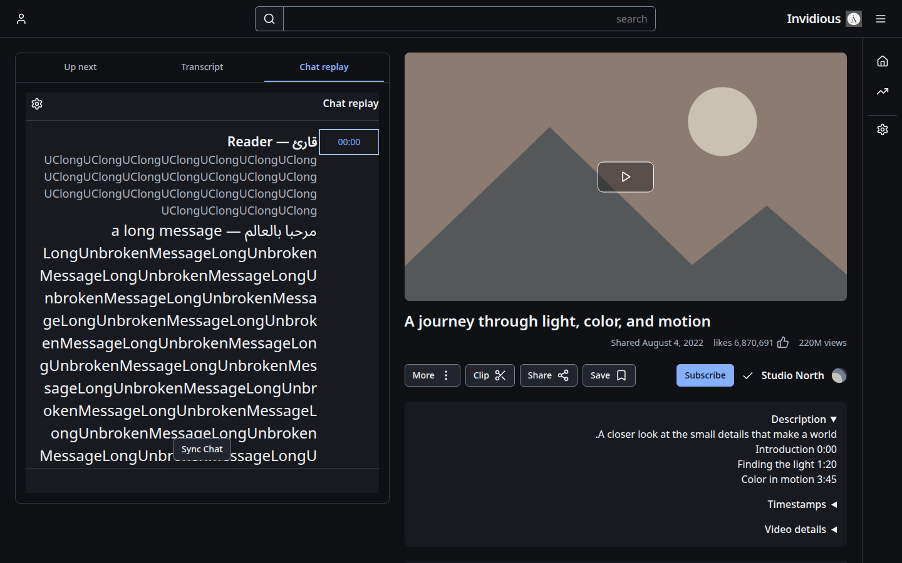

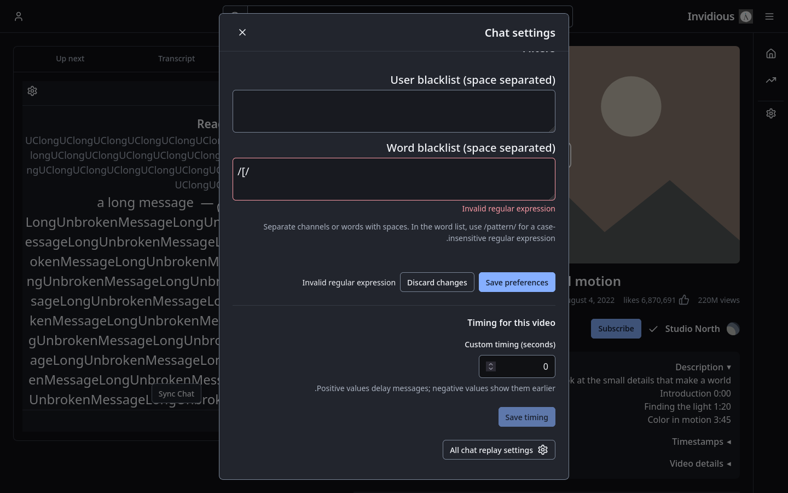

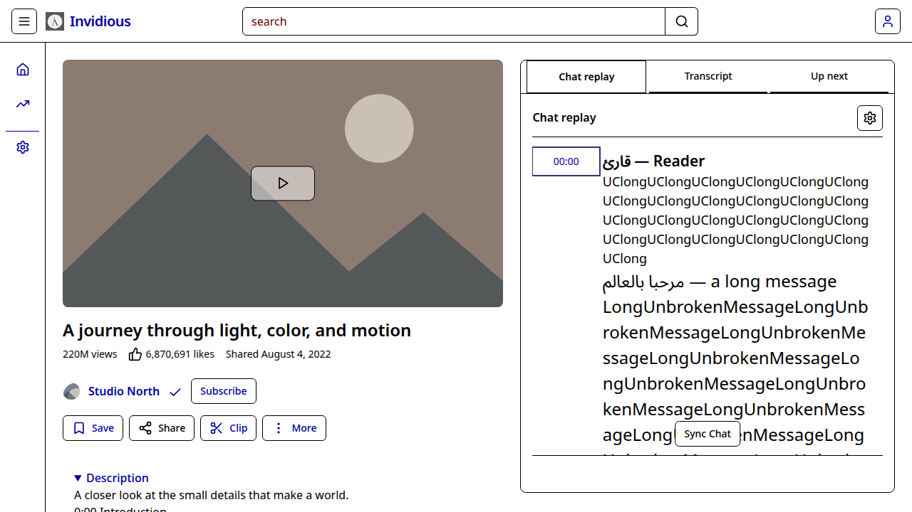

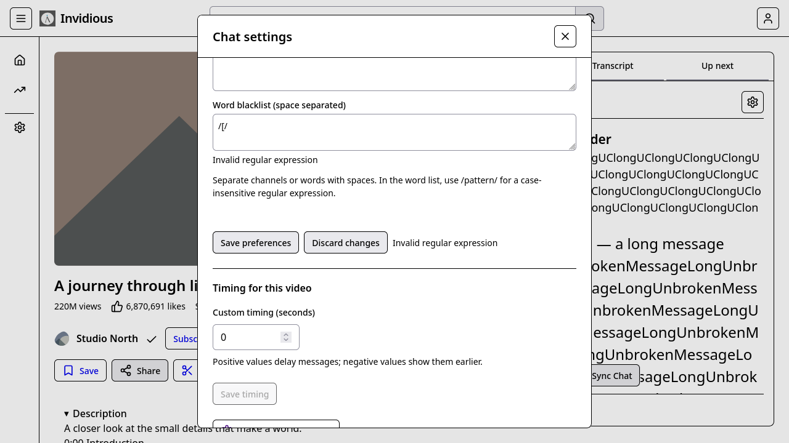

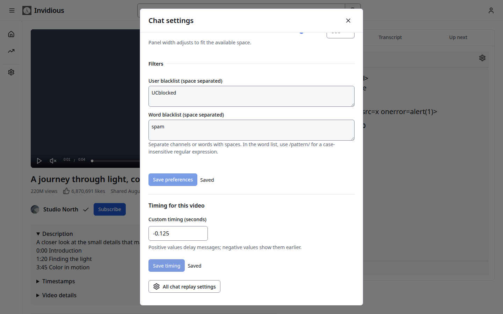

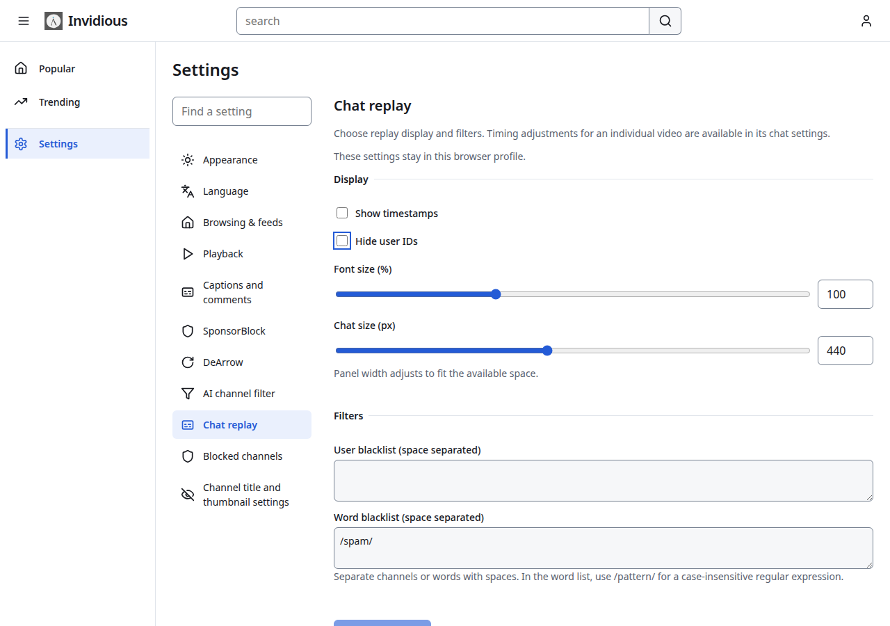

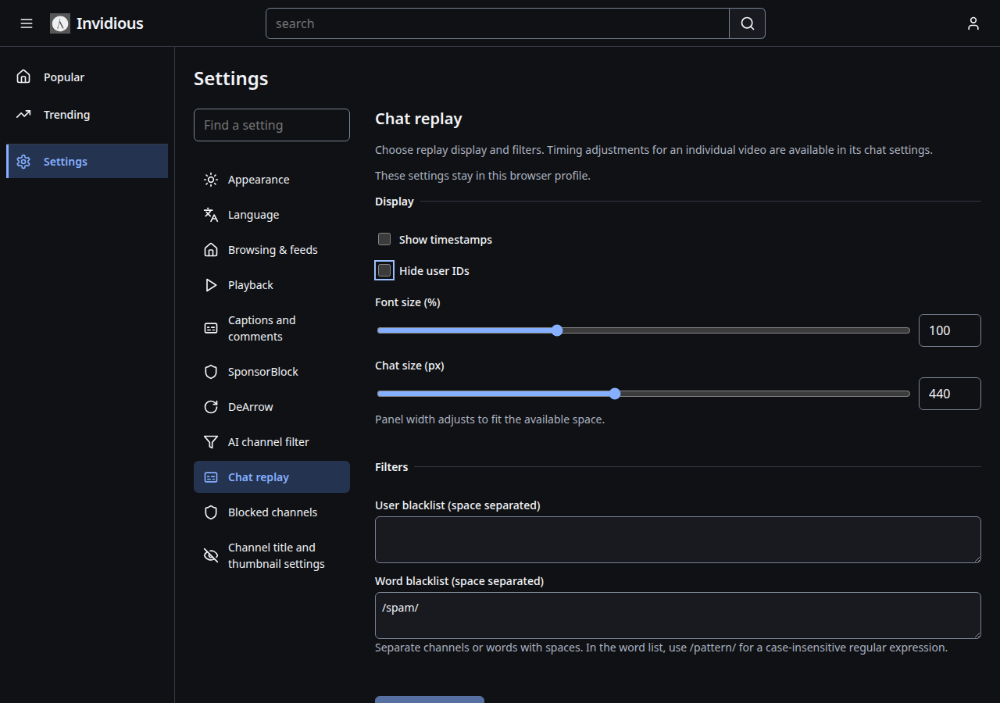
