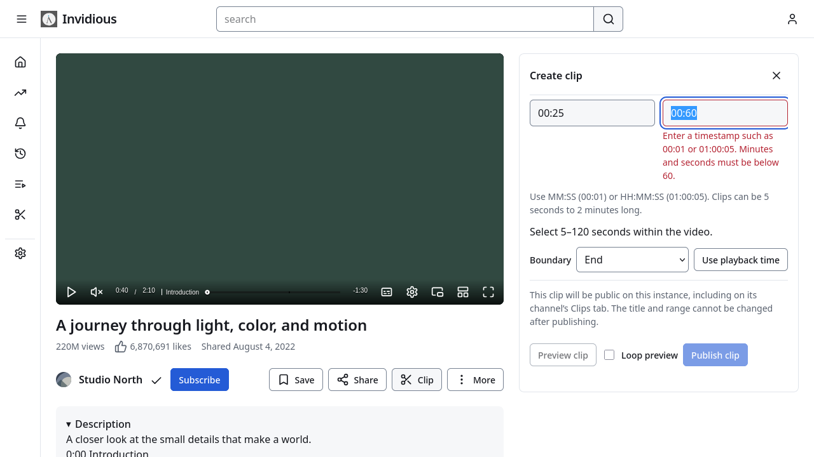
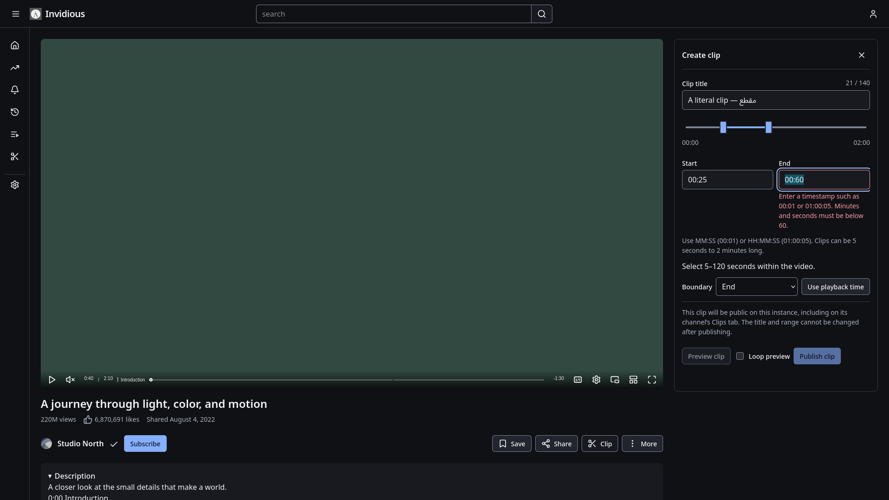
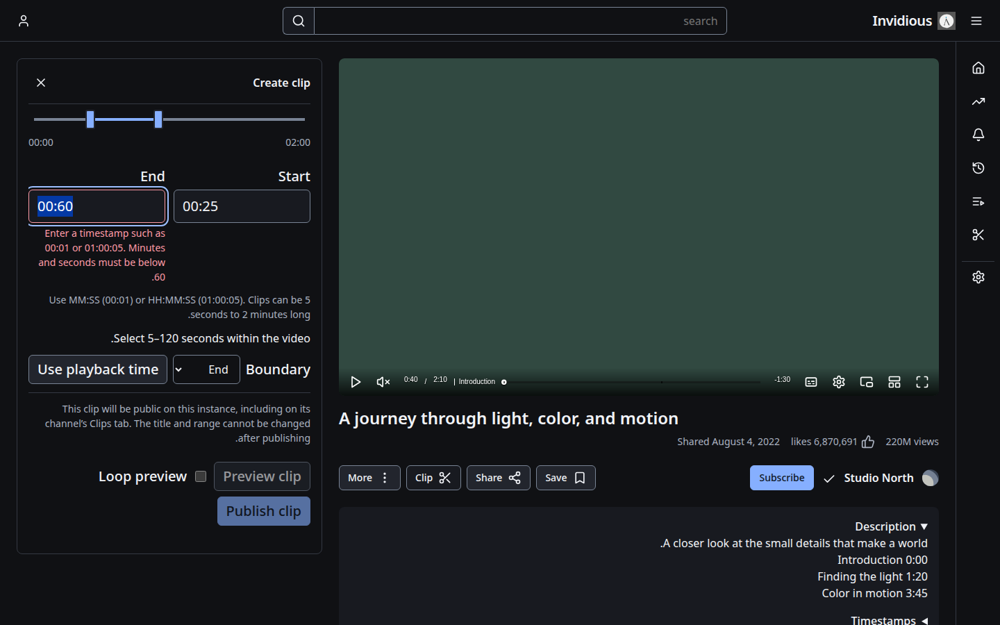
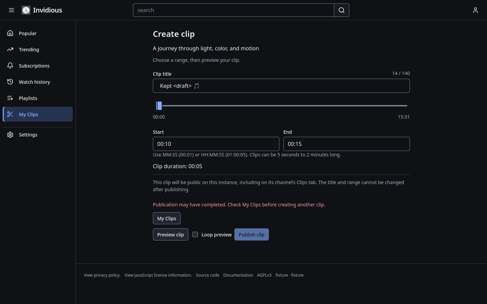
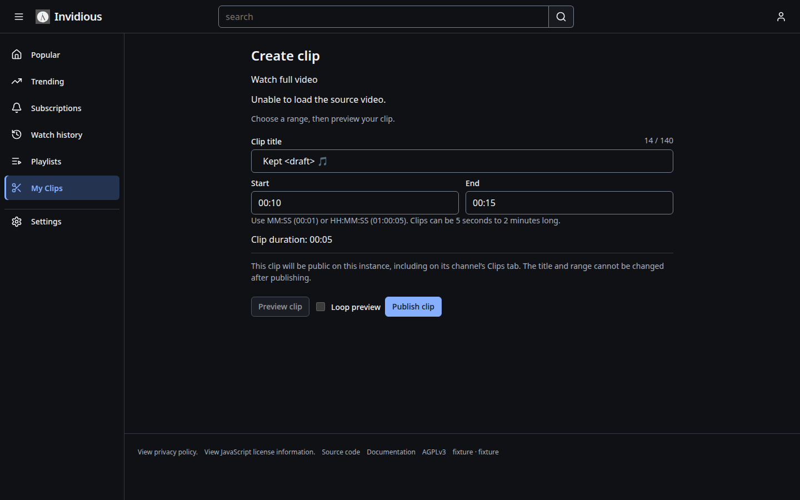
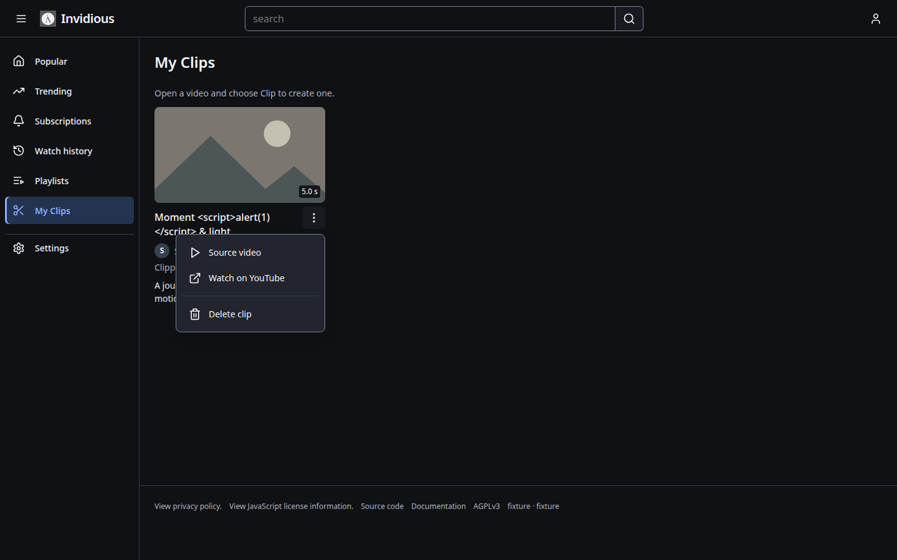
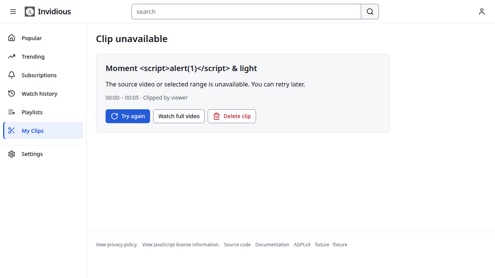
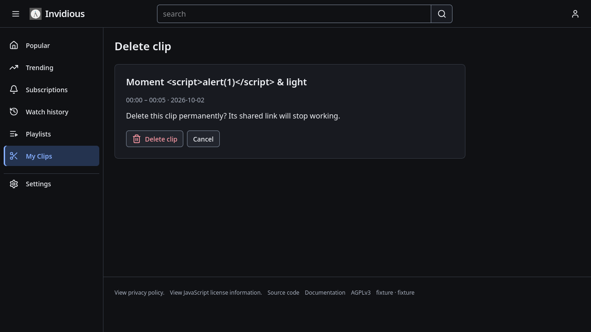

# D6 same-player clip editor and library checkpoint

[Master plan](README.md) · [Clip contract](d6-clip-contract.md) · [Source/check evidence](review/d6-clips-evidence.json) · [Next workstream](d6-enhancements-contract.md)

The clip workstream is accepted. D6 remains in progress: enhancement editors,
contributions and their coexistence still require implementation and acceptance.
D7–D9 remain subsequent stages.

The watch Clip action opens a temporary utility editor, including when no other
utility exists. Preview uses the existing media and restores time, playback,
looping, native bounds, prior utility selection, layout and focus. Closing keeps
the draft. Range handles, timestamps and one selected-boundary capture control
share validation for 5–120 seconds and the 140-character title limit. Publication
is explicitly public and its title/range immutable.

Editing positions never enter local/account progress, completion or automatic
queue advancement. Docking and SponsorBlock skips are suspended during editing.
Native fractional bounds survive previews outside their saved range and an
actual source refresh. Page/cache/profile/disposal ownership rejects stale
callbacks and restores only the correct page/profile's state.

Definitive publication rejection retains an editable draft. An ambiguous POST
retains its draft, disables immediate duplicate publication and links to My Clips
for reconciliation. A successful response received after closing is shown on
reopening. The standalone form uses the same controls and retains literal failed
POST fields through missing metadata, source errors and expired CSRF. Ambiguous
standalone publication also blocks Publish without JavaScript. Existing direct
GET error statuses, native API shapes/scopes and numeric form compatibility are
preserved. Lazy-asset failure retains the timestamp-aware standalone fallback;
guest sign-in returns to the requested clip editor.

My Clips, deletion and unavailable-source records use the shared design. Native
playback, creator/source attribution, owner-only deletion, channel cards,
pagination, cache eviction and unavailable-record retention remain intact.
Generic application error-page consolidation remains D7; unused legacy dialog
code and retired-style assertions remain D8.

Validation on 27–28 October 2026:

- Complete cumulative desktop suite: **198/198**, Chromium and Firefox. This
  includes 26 clip cases and the accepted earlier-stage/replay/utility behavior.
- Supplemental standalone range-style checks: **2/2** after visual review found
  and corrected shared-form CSS covering the timeline.
- Clip/player/progress/parser units: **29/29**; clip validators: **7 examples**;
  QoL regressions: **28/28**.
- Guarded task-owned local PostgreSQL checks pass native migration/schema,
  scopes/CSRF/ownership, fractional bounds, legacy resolution, ordinary forms,
  source/CSRF/database failure drafts, cache/pagination and account deletion.
- Fresh fixture build/render, normal/API-only type checks, formatting, syntax,
  generated references and documentation/whitespace checks pass. Existing
  monotonic-time deprecation warnings remain.
- Fifteen retained views were manually inspected across Light/Dark, desktop
  widths, enlarged RTL, forced colors, standalone failures and owner actions.
  The eight approved D1 images and ten native comment JSON hashes are unchanged.

The manifest retains source/image digests, case names and logs. These are local
checks using synthetic media and intercepted browser responses; no upstream or
deployed-host verification is claimed. Earlier manifests are preserved.

## Inspected examples

