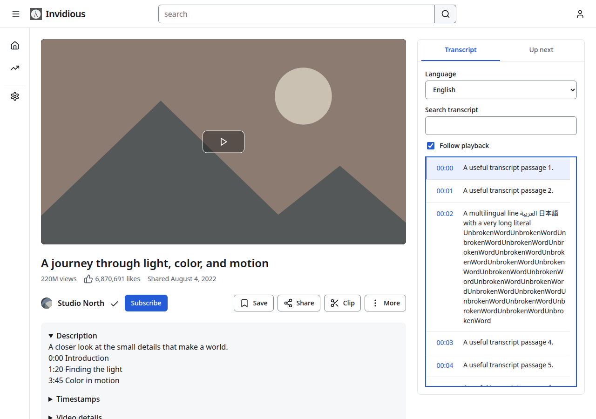
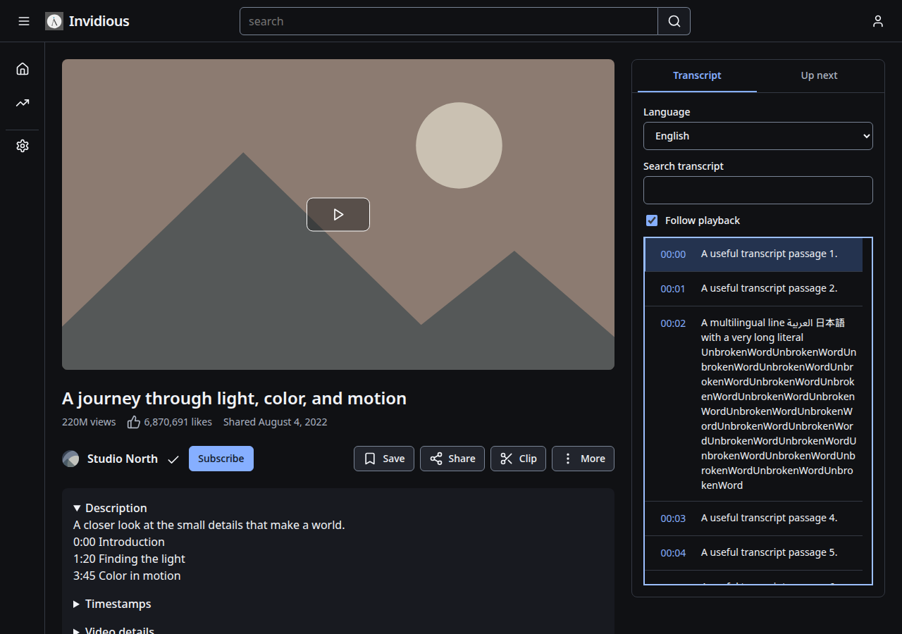
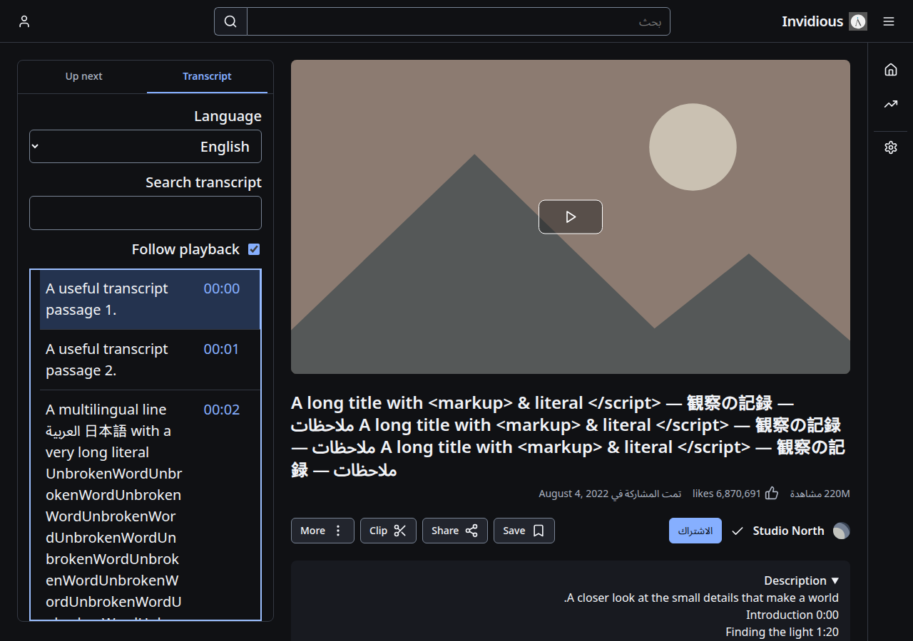
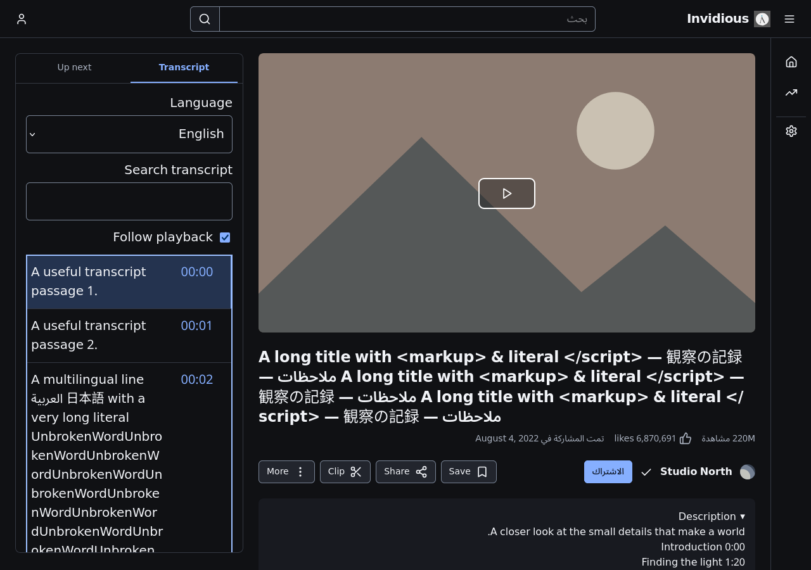
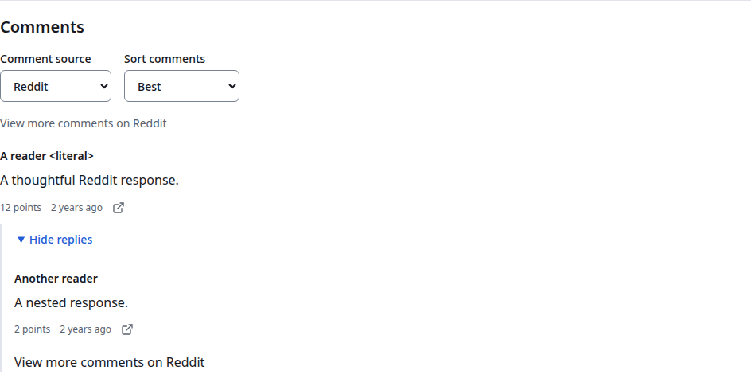
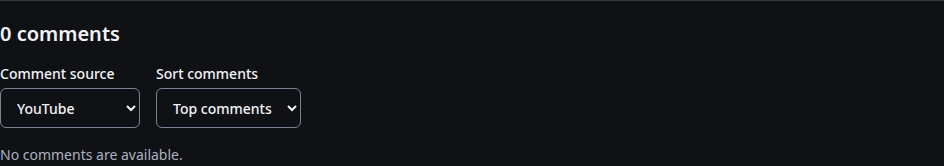

# D6 transcript and comment checkpoint

[Master plan](README.md) · [D6 contract](d6-contract.md) · [Progress](progress.md) · [Recorded evidence](review/d6-utilities-evidence.json)

**D6 remains in progress.** This checkpoint records the transcript and comment
workstreams, not acceptance of replay chat, clips, enhancements or the whole goal.
The user-approved D1 direction remains unchanged.

The transcript is one deliberately opened utility section. Its owner cancels
hidden, replaced-language, stale-profile and departed-page reads, resumes pending
reads after a cached-page return and rejects transport completions that ignore
abort. It retains at most five language results in memory. Search uses safe text
and makes no requests. Current-line lookup uses the full timeline, so a filtered
line cannot cause an earlier matching line to be highlighted. Seeking retains the
existing media. Manual scrolling/search disables Follow; explicitly enabling it
scrolls only the transcript viewport. Unavailable, failed, empty, invalid and
no-match results remain distinct; explicit Retry also refreshes a cached empty
response. Keyboard focus stays visible and viewport keys do not change playback.

Watch, post and community comments share one reader and delegated reply controls.
Watch source/sort controls remain outside replaceable results, preserve each
source's chosen sort and retain independent opaque cursors. Replies begin
collapsed; fetched replies can be hidden again. Continuations append without
removing prior threads, and failures keep their original controls. Known disabled
YouTube comments offer the other source without making a doomed initial read.
Reddit uses the same compact article/meta layout and native collapsible replies,
with explicit links for additional upstream replies. Auxiliary Reddit labels do
not repeat an original video title. Pinned labels, avatars, badges, attachments,
permalinks and thin-mode avatar suppression remain supported.

No-JavaScript YouTube continuations use ordinary watch links with separate
`comments_continuation` and sort/source parameters. Watch normalization removes
accidental spaces only from the video ID, preserving opaque cursor values.
Native clip fallback links retain their clip destination. The ten original
native comment JSON hashes remain unchanged. Only intentional HTML projections
were refreshed, using the maintenance switch that first verifies all frozen JSON
hashes; a subsequent ordinary fixture run passed without rewriting anything.

Validation on 27 October 2026:

- Complete desktop suite: **146/146**, including all earlier D1–D5 cases.
- Focused D6 and shared post/community readers: **20/20**.
- Complete QoL suite: **28/28**; existing transcript/avatar preservation cases: **4/4**.
- Fresh production fixture build and complete fixture/parser checks passed.
- Normal and API-only type checks passed, with four pre-existing monotonic-time deprecations each.
- JavaScript syntax, Crystal formatting, generated references, documentation links and whitespace checks passed.

The [manifest](review/d6-utilities-evidence.json) retains source/image hashes and
case names. These are local production-template checks with synthetic media and
intercepted responses; no live upstream or deployed-host verification is claimed.
The broader final consolidation and semantic documentation audit remain D8/D9.

## Inspected views

