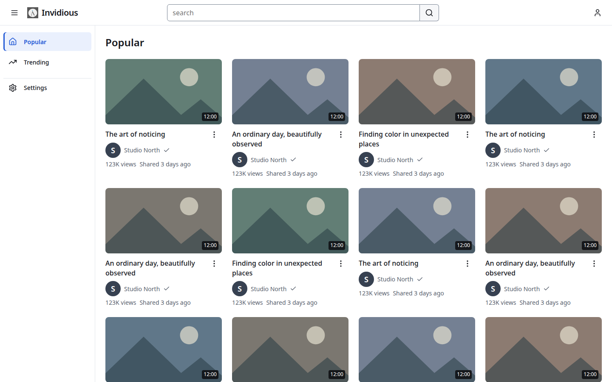
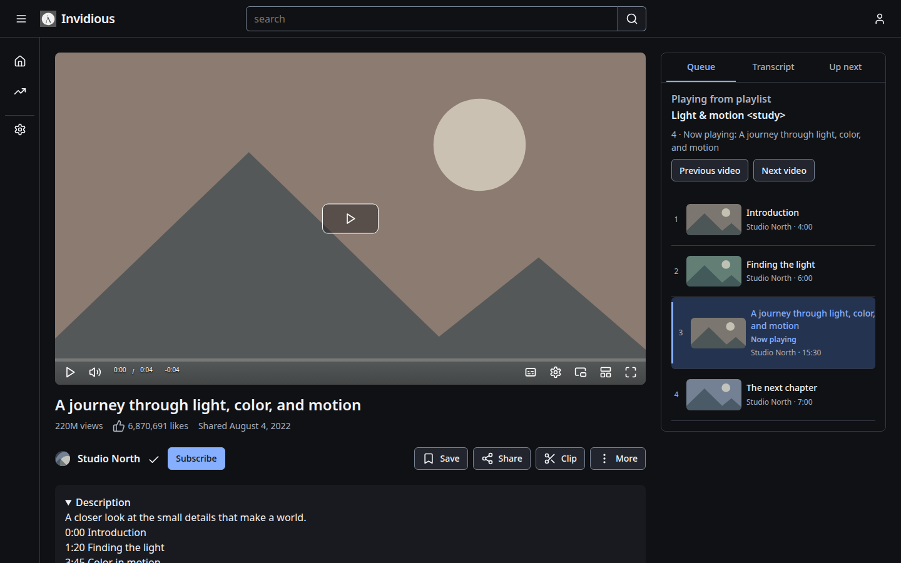

# Current interface previews

These are the final D8 synthetic production-template fixtures, inspected on
1 November 2026. They show repository behavior at 1440×900 in Chromium, with
local thumbnails/video and fixture accounts. They are not deployed-server captures.
The user approved the original visual direction at the [D1 checkpoint](../docs/uiUXOverhaulPlan/visual-checkpoint.md).

| Screen | Light | Dark |
| --- | --- | --- |
| Browsing | [Light browsing](../docs/uiUXOverhaulPlan/review/d8-pending/images/resumed-2026-11-01-chromium-browse-light-1440.png) | [Dark browsing](../docs/uiUXOverhaulPlan/review/d8-pending/images/resumed-2026-11-01-chromium-browse-dark-1440.png) |
| Watch | [Light watch](../docs/uiUXOverhaulPlan/review/d8-pending/images/resumed-2026-11-01-chromium-watch-light-1440.png) | [Dark watch](../docs/uiUXOverhaulPlan/review/d8-pending/images/resumed-2026-11-01-chromium-watch-dark-1440.png) |
| Playlist | [Light playlist](../docs/uiUXOverhaulPlan/review/d8-pending/images/resumed-2026-11-01-chromium-playlist-light-1440.png) | [Dark playlist](../docs/uiUXOverhaulPlan/review/d8-pending/images/resumed-2026-11-01-chromium-playlist-dark-1440.png) |
| Settings | [Light Settings](../docs/uiUXOverhaulPlan/review/d8-pending/images/resumed-2026-11-01-chromium-settings-light-1440.png) | [Dark Settings](../docs/uiUXOverhaulPlan/review/d8-pending/images/resumed-2026-11-01-chromium-settings-dark-1440.png) |

[Enlarged RTL browsing](../docs/uiUXOverhaulPlan/review/d8-pending/images/resumed-2026-11-01-chromium-browse-rtl-enlarged.png)
and [forced-color watch](../docs/uiUXOverhaulPlan/review/d8-pending/images/resumed-2026-11-01-chromium-watch-forced-colors.png)
add accessibility views. [D8 acceptance](../docs/uiUXOverhaulPlan/d8-acceptance.md)
and its immutable manifest retain exact image hashes, inspection findings,
Firefox coverage and local/physical-device limits. The directory's `d8-pending`
name is historical; these accepted files must not be overwritten.

## Historical upstream screenshots

Other existing images in this directory show the earlier upstream interface.
They are retained as historical material and do not illustrate the current fork.
Use the gallery above for current guidance and [frontend verification](../tests/frontend/README.md)
to generate a new explicitly dated review set.
